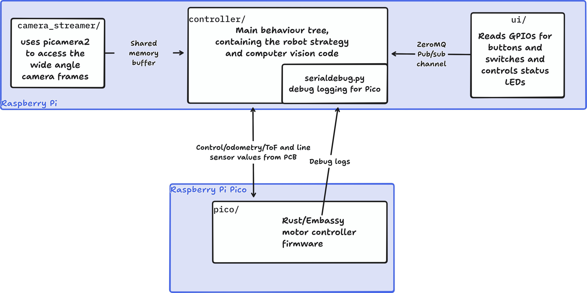

# Team High Scorers RoboCup 2026 Repository

This is the monorepo for the High Scorers RoboCup Junior Opens Soccer team. When browsing code,
it is highly recommended to browse in an editor with "Go to definition" support. If you are viewing from
GitHub, press the `.` key to open in an online VSCode instance.

[**Onshape CAD here**](https://cad.onshape.com/documents/ea45f627640093c41ce29f68/w/55dbcc8e0fa51676d6d22381/e/4ebe9911eb0a9aed26b8f2e8?renderMode=0&uiState=6aed85551ba35b1558f578c4)

## Project structure

## License

All software in this repository is licensed under the [MIT license](./LICENSE).
Hardware (including the PCB under `motor-controller-pcb/` and the CAD export at
`Main Assembly.step`) are under the CERN OHL-P (permissive).
